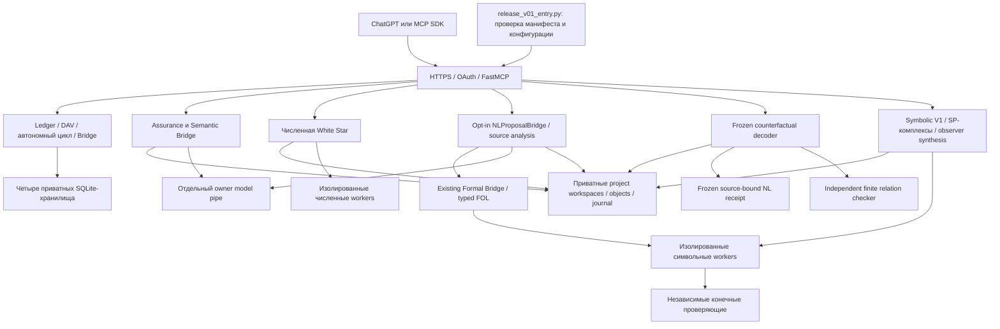
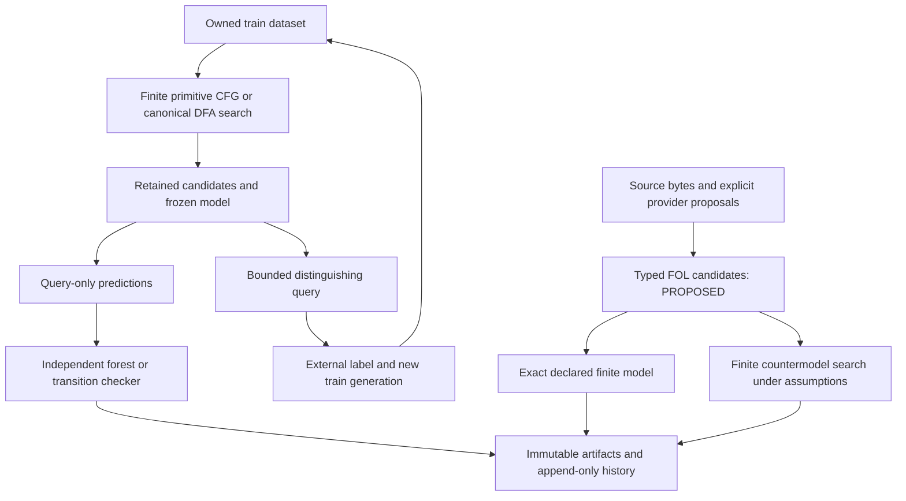

# Архитектура MCP-сервера LivingMath

Срез архитектуры: **v0.4.11-developer-preview**, пакет Python `0.4.11.dev0`.
Production объединяет **94 MCP-инструмента** в одном authenticated Streamable HTTP
endpoint `/mcp`. [Справочник интерфейса](docs/MCP_INTERFACE.md),
[установка](docs/INSTALL.md), [примеры запросов](docs/USAGE.md).

## Компоненты и потоки

HTTP-процесс проверяет входной контракт, проект и ссылки, сохраняет запрос,
направляет ограниченное задание worker и возвращает результат с происхождением.
Model pipe предлагает интерпретации; вычислительные workers и независимые
проверяющие не используют LLM. Проверка вычислений не удостоверяет смысл текста.

## Точки входа и сборка приложения

| Файл | Назначение |
|---|---|
| `tools/release_v01_entry.py` | Действующая production-композиция. Проверяет owner-only конфигурацию, SHA манифеста и каждого файла, точное разрешение владельца; загружает сохранённый legacy слой и добавляет новые инструменты |
| `tools/release_isolation.py` | Расширяет Landlock allowlist на установленный неизменяемый release слой, сохраняя запрет доступа к операторским/приватным источникам |
| `live_math_mcp_prod/unified_deploy.py` | Загрузка и проверка legacy deployment; установка hooks в существующий transport |
| `live_math_mcp_prod/production020.py`, `beta019_http.py`, `deploy018_http.py` | Сохранённая HTTP-композиция, lifecycle, transport и OAuth через существующий стек |
| `live_math_mcp_prod/unified_system/server.py` | Регистрирует Bridge, статус компонентов и доступ к исходным схемам; подключается к DAV и автоматическому циклу |
| `live_math_mcp_prod/unified_system/local.py` | Отдельный новый локальный legacy экземпляр: `prepare`, `serve`, реальный HTTPS/OAuth `smoke`; **44 инструмента** |
| `live_math_mcp_prod/mcp_server.py` | Исторический stdio ledger. Сам по себе не запускает объединённый production интерфейс |
| `src/lm_suti_assurance/cli.py` | Команда `lm-suti`: локальная работа с проектами, источниками, проверками и offline bundles |

Production entry вызывает `register_tools` assurance, Semantic Bridge, White Star,
Symbolic V1 и extensions поверх существующей регистрации legacy/Bridge. Версия
верхнего сервера обновляется отдельно от сохранённых версий вложенных контрактов.
Не следует менять старый `assurance_contract.release`, чтобы он совпал с номером
всего продукта: это разные версии совместимости.

## Исследовательские модули

| Каталог/модуль | Ответственность |
|---|---|
| `live_math_mcp_prod/research_store.py` | SQLite ledger: события, миграции, исходные хеши, аудит и проверки целостности |
| `frontier.py`, `move_lifecycle.py` в том же каталоге | Версии обязательств/фронтира, структурированный аудит и отдельные решения жизненного цикла исследовательского хода |
| `live_math_mcp_prod/davcore/` | Адаптеры наблюдений, конечные модели, проверки законов, контрпримеры и свидетельства |
| `live_math_mcp_prod/research_automation/` | Сохраняемый автоматический исследовательский цикл и управление его состоянием |
| `live_math_mcp_prod/artifact_translation/`, `semantic_repair/` | Контракт `livingmath-artifact/1`, исходные тексты/rights, разбор, source alignment и компиляция условной модели |
| `live_math_mcp_prod/unified_system/assets.py`, `assets/unified/` | Проверка и загрузка SHA-bound исходных схем SUTI и модели ALCH006 |
| `src/lm_suti_assurance/service.py`, `validation.py`, `policy.py` | Импорт source/task/candidate, отдельное подтверждение точной задачи, конечные решения и политика экспорта |
| `src/lm_suti_assurance/_frozen/` | Сохранённые независимые checker/binder; их байты и identity закреплены baseline lock |
| `src/lm_suti_assurance/semantic_bridge/` | Адресные UTF-8 цитаты, версии прочтений, сравнение и свидетельства потери различения |
| `src/lm_suti_assurance/white_star/` | Контракт численного запуска, подготовка native ядра, worker pool, frames/views, provenance, экспорт и replay |
| `src/lm_suti_assurance/white_star/vendor/` | Поставленные исходники Белая звезда → CAD → Удав; происхождение описано в THIRD_PARTY_NOTICES |
| `src/lm_suti_assurance/symbolic/` | Полные токенные слова, lineage/DAG, ограниченный поиск, грамматические гипотезы и замороженное предсказание |
| `src/lm_suti_assurance/symbolic_complex/` | Конечный позиционный SP 2-комплекс, границы над F2, локальные peaks, путевые сертификаты и независимый `checker.py` |
| `src/lm_suti_assurance/observer_synthesis/` | Train-only feature registry, происхождение BUILTIN/DERIVED, контексты, зависимости и эффективная ablation |

Пути без префикса в строке lifecycle относятся к `live_math_mcp_prod/`.
MCP-адаптеры находятся в соответствующих `mcp.py`; сервисы хранят состояние,
contracts определяют входы, workers исполняют только фиксированные действия.

## Контекст → новый наблюдатель → независимая проверка

В `observer_synthesis/contexts.py` строятся реальные операторные контексты.
`promotion.py` рассматривает размеченный train-only witness, требует достаточных
меток исходника/результата/фрагментов и совместимости со всем train. Получаются
зарегистрированный literal anchor и зависимый bounded context scan.
`operator_execution.py` исполняет существующие SPLIT/CONCAT и точные сравнения;
`features.py` применяет feature policy и denylist, включая реальные зависимости.

`promotion_verifier.py` отдельно повторяет primitive steps, промежуточные хеши,
source spans, родителя, scope и train coverage; он не вызывает producer.
`independent_verifier.py` направляет такой тип сертификата новому checker,
сохраняя прежний путь проверки. `learner.py` фиксирует гипотезу до предсказаний;
`symbolic_complex/app.py` передаёт queries без скрытых меток.

`CHECKED_INSTANCE` относится к предъявленному конечному свидетельству. За пределами
scope возможен `UNKNOWN`, при недостатке данных — `UNDERDETERMINED` или
`NO_VERIFIABLE_NEW_OBSERVER`. Заданный контекст сам по себе не новый инвариант.
[Положительный конечный результат и отрицательные контроли](docs/symbolic-v1/v044-reacceptance/USER_REPORT_RU.md).

## Рекурсивный наблюдатель PATCH004

Дополнительный `request.promotion_policy` выбирает композиционный путь; без него
работает прежнее продвижение буквальных контекстов. Это четыре закрытые формы
существующего AST, без пользовательского языка исполнения.

| Модуль `observer_synthesis/` | Назначение |
|---|---|
| `composition_ast.py` | Проверка формы/типов/убывания, исполнение существующих SPLIT/REVERSE, полное равенство слов и source-state trace |
| `compositional.py` | Train-only генерация структурных разрезов/сравнений, сохранение совместимых альтернатив и отклонённых контрпримеров; admission только после checker |
| `composition_checker.py` | Независимая реконструкция UTF-8 источника и повтор каждого primitive step; строгие JSON-типы, полный train coverage, происхождение и scope |
| `source_bridge.py` | Чтение настоящего сохранённого Symbolic V1 run того же проекта, проверка input/result/kernel/AST и train-семантики |

Источник старой грамматики связывается по буквальным токенам и меткам train;
этого недостаточно для тождества изданий источника. Новый certificate отдельно
связывает полные записи нового train, исходные UTF-8 байты и spans.
Генератор использует train и structural tie-break; queries не участвуют в fit.
`feature_id` связывает AST, область и исполняемые операторы. Проверка не даёт
execution grant; family остаётся `UNDERDETERMINED`, вне scope — `UNKNOWN`.

Область композиционного preview: максимум 8 токенов, 32 узла AST, глубина 8,
8 рекурсивных шагов, 256 train witnesses. Прежний контекстный предел 64 и
worker CPU5s/wall6s/RAM512MiB сохранены. Все current/historical символьные
профили делят один лимит 2 active / 16 queued; численные workers — отдельный pool.
Архивные профили 0.4.3/0.4.4/0.4.5 проверяются по owner-approved manifests
и используются для прежних replay/verification, не переобучают старые runs.

## Генератор смешанных длин PATCH005

`observer_synthesis/compositional.py:typed_skeletons` предлагает literal alignment
и его строго убывающее рекурсивное замыкание для наблюдаемых координат независимо
от самого короткого положительного слова. Затем добавляет ограниченные AND
refinements положительных наблюдений и прежние whole-fragment comparisons.
Catalog конечен (до29 shapes в данной области), не перечисляет все программы.
Каждый кандидат проходит отдельные type/termination, scope и full-train стадии.

`generation_diagnostics` сохраняет grammar version, train-length histogram,
AST digests, counts, sample IDs/expected/observed для фактических ошибок,
отдельные generation/train/promotion статусы. Усечение max_proposals или
AST/recursion bound означает BOUNDED_SEARCH_INCOMPLETE, не невозможность грамматики.
Сводка компактна; подробности находятся в existing model/diagnostics sections с
pagination/artifact chunks. `learner.py` фиксирует модель до queries.

Существующие composition_ast.py/composition_checker.py и feature-id formula
побайтно сохранены. Утверждённый generator provenance ID прежний, новый source
SHA связывает новые constructors. Исторические runs направляются прежним
approved0.4.6 worker, разделяя общую квоту; Symbolic V1 grammar не меняется.
[Контракты диагностики](docs/symbolic-v1/patch005/QUICKSTART_RU.md).

## Ролевые ветвящиеся программы DYCK006

Этот additive opt-in путь выбирается `promotion_policy.mode=role_branching_ast`;
`auto` использует его, когда прежняя equality promotion не дала наблюдателя.
Два ATOM_ROLE связываются с различными атомами train; генератор перечисляет их
перемежения с0/1/2 строго убывающими RECURSE и EPS/NONE базами. Для бинарного
алфавита проверяются40 программ. Это конечный типизированный catalog, без
встроенного распознавателя Dyck, высотного признака или готового reference AST.

| Модуль `observer_synthesis/` | Назначение |
|---|---|
| `role_ast.py` | Исполнение конечной программы, interval DP, source-bound дерево с обеими ветвями и фактическими SPLIT/CONCAT |
| `role_checker.py` | Отдельный парсер источника и recurrence, полное покрытие интервалов/разрезов, обе ветви, роли, UTF-8 spans и буквальная реконструкция |
| `role_promotion.py` | Генерация bindings/кандидатов только из train, контрпримеры, rivals, scope и admission после independent checker |

`features.py` использует решение checker, а не scalar answer producer.
`independent_verifier.py` добавляет dispatch, не меняя старый checker.
`symbolic_complex/app.py` переиспользует существующий worker action observer_verify;
`service.py` связывает optional query_id с реальной записью того же проекта/run.
Worker whitelist, старые composition evaluator/checker и Symbolic V1 сохранены.

Пределы role: по умолчанию8 tokens, явно до12,91 interval cells,512 split trials,
32 AST nodes, глубина/recursion8. Старые8-token equality bounds не расширяются.
CPU5s/wall6s/RAM512MiB и общая historical/current квота2 active/16 queued прежние.
Выход за scope даёт UNKNOWN; negative certificate доказывает только конечный
отрицательный ответ полным DP, не отсутствием найденного положительного дерева.
Роли буквальны: переименование токенов вместе с bindings ковариантно;
переименование при фиксированных ролях и NF факторизация — иные операции.

P1 harness фиксирует один hypothesis_digest для32 inference batches, получает
8191 настоящих query decisions, строит множества суффиксов и различающие witnesses.
Он не группирует по высоте. HTTP429 retry находится только в QA transport,
срабатывает только на явный pre-execution018_RESOURCE_BUSY, сохраняет request key.
[Схемы и контракт](docs/symbolic-v1/dyck006/QUICKSTART_RU.md).

## Formal Bridge v1

Восьми новым MCP tools соответствует отдельный opt-in namespace;83 старых
контракта сохранены. Сервис использует тот же Workspace и общий isolated executor
через существующий observer_verify action; whitelist исходного worker не изменён.

| Модуль `formal_bridge/` | Назначение |
|---|---|
| `ir.py` | Closed grammar/DFA IR, UTF-8 source binding, explicit finite bounds и CPU/step accounting |
| `search.py` | Data-bound terminal relations, EPS/center/literal bases, sequence shuffles, ALT и независимый start; compatible rivals и контрпримеры |
| `chart.py` | Least fixed-point chart, complete packed alternatives, конечные expanded trees и UNKNOWN для циклов/лимитов |
| `dfa.py` | Ограниченный поиск полных transition tables по prefix constraints; канонизация BFS state names, trace |
| `proof_checker.py` | Отдельная source reconstruction и saturation/transition verification; без импорта search/producer |
| `fol.py` | Source links, scoped variable sorts, proposed interpretations, exact closed finite models и assumption-aware contrast |
| `engine.py` | Чистые worker operations; fit без queries, seal, independently checked predictions и общий synthesis CPU budget |
| `service.py` | Owned refs, idempotent reserve/finish, recovery, blobs, pagination, replay; без новых SQLite |
| `contracts.py`, `mcp.py` | Восемь bounded additive APIs в том же FastMCP/HTTPS/OAuth |

CFG search перебирает объявленный каталог, не все КС-грамматики. Структурные
терминальные и короткие train-контрпримеры отсеиваются до полного fit; они остаются
в diagnostics. Short negative pair pruning применим только к nullable/pair base,
не к center base. Генерация сама ограничена CPU/steps, алфавитом≤4 и8192 shapes;
max_candidates128 относится к full-train этапу после явных pruning checks.

DFA search рассматривает states1…4 и останавливается на первом совместимом
уровне; это ресурсная политика, не теорема глобальной минимальности.
Packed CFG forest повторно проверяется отдельной global saturation, positive
содержит production/child order/spans/start/SHA; negative требует полного chart.
UNKNOWN_BOUND/UNKNOWN_CYCLE не превращаются в false.

FOL provider явно передаёт proposals (human/imported/external provenance).
Сервис не декодирует произвольный русский текст. Typechecked syntax, proposed
source alignment и truth in a stated finite model — отдельные статусы.
Контрмодель сравнивает кандидатов только там, где все их предпосылки истинны.
Старые numerical/Symbolic/role/SP/frozen kernels и четыре SQLite не меняются.

## Данные и происхождение

| Хранилище | Что сохраняет |
|---|---|
| Canonical SQLite | Исходные исследовательские события, обязательства, аудиты, lifecycle/history |
| Typed SQLite | Сохранённые типизированные source-cycle/native-preview данные legacy слоя |
| DAV SQLite | Адаптеры, наблюдения, исследовательские cases, checkpoint/result и происхождение |
| OAuth SQLite | Клиенты и состояние авторизации; не исследовательское свидетельство |
| `assurance_state/<project>/objects/` | Неизменяемые JSON-объекты по SHA-256: источники, задачи, модели, результаты |
| `assurance_state/<project>/journal.jsonl` | Логически append-only история с `seq`, `previous_hash`, `hash` и `request_key` |
| Приватные export/artefact каталоги проекта | Data-only bundles и большие постранично читаемые результаты |

Корни хранилищ задаёт приватная operator-конфигурация. Workspace проверяет owner
permissions, SHA объектов и цепочку журнала, использует file lock, atomic write и
fsync. Физическая запись журнала атомарна; смысловая история остаётся append-only.
Это не распределённая БД и не многопользовательская ACL-система.

Похожие имена проектов в legacy и assurance не означают общий namespace:
идентификаторы и их схемы принадлежат конкретному API. Source addresses и
evidence refs проверяются в своём проекте. Для нового symbolic проекта сначала
вызывается `assurance_project_new`, иначе допустим `NOT_FOUND`.

## Изоляция и replay

- OAuth/PKCE и точные origin/resource binding защищают HTTP-вход. Секреты и
  операторские approvals не передаются в вычислительные задания.
- Численный `white_star.pool.Pool` и символьный `symbolic.executor.Executor`
  используют отдельные процессы. Для symbolic current и исторических profiles
  действует один `SharedBudget`: 2 активных задания, очередь 16. Численный pool
  имеет собственную квоту; это не общий лимит всех процессов сервера.
- Для вычислительного job заданы CPU 5 s, wall 6 s, RAM 512 MiB; startup/native
  compilation — отдельные стадии. Workers запрещают сеть и произвольную запись,
  читают только разрешённый установленный код/библиотеки. LLM в них не вызывается.
- Экспорт содержит данные, source hashes, исходный request и binding. Replay
  вычисляет результат установленным kernel; Python из ZIP не исполняется.
- Старые kernels разрешены только как owner-installed immutable profiles с
  точными манифестами; клиент не может выбрать произвольный файл worker.
- `request_key` повторяет прежнюю операцию. Для проверки новой реализации нужен
  новый ключ; старые результаты и цепочки не переписываются.

## Проверка и эксплуатация

`tests/` покрывает новый пакет; `live_math_mcp_prod/test_*.py` — legacy.
`tools/*mcp_qa.py` проверяют настоящий MCP-клиент, schemas, replay, idempotency,
изоляцию проектов и поддельные свидетельства. Unit PASS не заменяет HTTP/OAuth.

При обновлении сначала сохраняются согласованные backups четырёх SQLite,
workspace objects и префиксы журналов; затем проверяется манифест нового слоя,
перезапускается HTTP и повторяется live acceptance. Туннель не требуется
перезапускать, если его upstream и origin остаются прежними.

`COMPLETED`, finite proof, source byte attestation и смысловая/физическая истина —
разные утверждения. Модель не присваивает себе `verified`; новые assurance и
White Star интерфейсы возвращают `execution_permission=false`. Сохранённый
legacy lifecycle эксперимента отдельно проверяет scoped grant и не превращает
его в математическое доказательство. HTTP018 отклоняет `activate_experiment` и
`complete` от MCP-клиента с `018_OPERATOR_AUTHORITY_REQUIRED`: эти действия
требуют отдельного операторского пути. Native SUTI остаётся `NOT_EXECUTED`, внешний
человеческий gate R3 — `PENDING`.

## NLProposalBridge/1

Отдельный namespace и две новые операции сохраняют прежние ядра.
[Модули, граф порождения, provider isolation и пределы](docs/nl-proposer002/ARCHITECTURE_RU.md).

## Frozen counterfactual decoder (0.4.11)

`formal_nl_redecode` → `nl_proposal/causal_mcp.py` (контракт и прежний inspector)
→ `causal_service.py` (owned run, SHA, replay gate, idempotency, append-only CAS)
→ `causal.py` (четыре arm и проверяемая primitive BFS) →
`finite_relations.py` (независимое перечисление явно ограниченных моделей).

Декодер не импортирует provider и не выполняет сетевые запросы. Перед вычислением
существующий `provenance.traces` проверяет принадлежность реального вычисления
проекту, source bytes и snapshot. SHA одного receipt, source packet, binders и
base AST общие для всех arm. SHAM меняет только decoder source_order.

CPU измеряется по текущему вычислительному потоку, с одинаковой зарезервированной
долей для каждого arm; максимум 4000 ms на вычисление, 8 кандидатов на источник.
При исчерпании границы возвращается UNKNOWN_BOUND. Inspector сохраняет прежнюю
схему и экспортирует новые data-only result/bundle с байтовой пагинацией.
Replay сравнивает содержательные SHA без замеров времени; расхождение границ
отмечается REPLAY_BOUND_DIVERGENCE. Исторический matched_ablation остаётся
воспроизводимым, но содержит двойную интервенцию и не используется как causal arm.

Ни типы, ни происхождение, ни конечные контрмодели не дают semantic licensing
или execution grant. [Полный контракт](docs/nl-causal003/QUICKSTART_RU.md).
