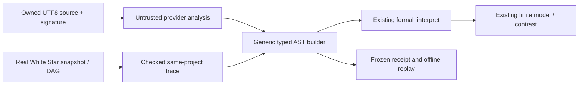

# Архитектура NLProposalBridge/1

Новый namespace `src/lm_suti_assurance/nl_proposal/` подключается только через
существующий release entry. Numerical75, symbolic_v1, observer_synthesis,
Formal Bridge и его worker ABI не изменяются.

| Модуль | Назначение |
|---|---|
| `contracts.py`, `mcp.py` | Два bounded MCP-контракта, capability, понятные статусы и полные страницы |
| `provenance.py` | Владение, источник, snapshot, существующие кадры/узлы/родители и дополнительные digest guards |
| `decoder.py` | Обратимая нормализация, source analysis, общий типизированный scope move, exact-AST dedup и offline replay |
| `provider.py` | Фиксированные prompt/schema/model, свежий вызов и полный receipt |
| `owner_pipe.py` | Владелец запускает provider до ограничения доступа HTTP-процесса; закрытая сериализованная pipe |
| `service.py` | Append-only `nl.start/finish`, admission, идемпотентность, ссылки на настоящие FormalCandidate и контрмодели |

Порядок spans из реального кадра предлагает перестановку кванторного spine.
Сервер пересобирает AST и повторно проверяет типы. Отсутствие декодируемого
различия сохраняется явно. Добавленная scope-гипотеза не выдаётся за следствие
текста, а геометрические веса никогда не переводятся в истинность или кванторы.
Имена задач, русские ключевые слова и holdout gold отсутствуют в правилах.
Сохраняются сырой набор, до/после AST, source links, competing refs и предпосылки;
совпадение на конечных моделях не удаляет разные AST.

У владельца должно быть существующее `codex login` через ChatGPT. Для запуска
нужна явная owner-конфигурация `nl_proposer={"enabled":true,"spool":"PRIVATE_PATH"}`
внутри `~/.local/state/livingmath`. Без неё provider недоступен. Клиент не может
выбрать исполняемый файл, путь, модель или credential. API keys убраны из
окружения дочернего CLI; tools/web/apps/plugins/skills отключены. Использование
[structured output Codex CLI](https://developers.openai.com/blog/eval-skills)
не устанавливает истинность ответа модели.

Лимиты: 4 активные задачи, один provider, 6 sources/задачу, 4 trace frames/source,
8 кандидатов/source, один модельный вызов, 4 CPU секунды decoder. Старые
численные и формальные jobs используют прежние 2 workers/16 queue,
5 CPU/6 wall секунд/512 MiB. CLI не предоставляет здесь жёсткого token stop:
usage проверяется после ответа; превышение отклоняет кандидатов. Seed управляет
исследовательским плечом, но seed/temperature/revision модели не закреплены
провайдером и помечаются UNKNOWN. Replay не вызывает модель заново.
