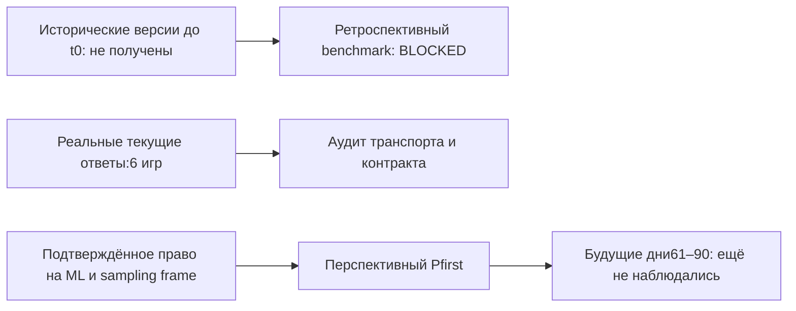

# ROBLOX-PRED-001: аудит источников

Дата проверки:2026-11-01. Пользователь подтвердил отсутствие собственных
Roblox-проектов, разрешённой аналитики и исторического датасета; выбран аудит
и перспективный протокол. Результат Stage0: **BLOCKED** для автоматического
ML-сбора/коммерческой оценки. Предиктивные результаты — **INCONCLUSIVE**.

## Реально выполненные запросы

В2026-11-01T16:17:59Z—16:18:02Z выполнены четыре ограниченных HTTP GET без
cookie/API key, без повторов, с явным User-Agent. Сырые ответы остаются
локально в `data/raw/source-audit/`, вне Git.

| Запрос | HTTP | Наблюдение |
|---|---:|---|
| `games.roblox.com/docs/json/v1` |404| Старый Swagger URL недоступен; контракт сверялся с актуальным Creator Hub |
| `games.roblox.com/docs/json/v2` |404| Такой же недоступный старый адрес; ошибка сохранена |
| `/v1/games?universeIds=1,2,3,994732206,383310974,111958650` |200|6 полных записей;3 с playing=0, остальные515176/304712/3479 |
| `/v2/users/1/games?accessFilter=Public&sortOrder=Asc&limit=10` |200|3 записи каталога; universe IDs295594/246424/13058 |

Шесть полных записей выбраны намеренно для проверки транспорта: три ранних test
ID и три известных проекта. Это не репрезентативная выборка и не eligible cohort.
Нулевой CCU не обозначен отрицательным90-дневным исходом. Всего просмотрено9
разных universe IDs, полные метаданные доступны для6. Даты создания2013–2019
не датируют текущие названия/описания. Измеренный временной срез — только2026-11-01.
Первый полный response SHA256:
`e61722f93ff196f1e3e3b45f761b0735848ba7f9daddbfdae31f1f1606adaa53`.

## Реестр источников

| Источник / URL | Доступ, охват, время | Sampling / cadence / time travel | Права, лимиты, проверка и решение |
|---|---|---|---|
| [Roblox Games](https://create.roblox.com/docs/cloud/reference/domains/games) | Public,6 проверенных полных записей; первый наш known_at2026-11-01T16:18:01.220462Z | Текущий мгновенный playing/накопленный visits; ручные seed IDs, не charts cohort; исторический запрос не подтверждён | Roblox Terms; HTTP200; автоматический ML-сбор BLOCKED, повторов нет;429 означает остановку |
| [Creator catalog](https://create.roblox.com/docs/cloud/reference/domains/games) | Public,3 записи creator1 | Ограниченное портфолио одного creator; не sampling frame всей платформы; не time travel | Те же ограничения; HTTP200; только сохранённый аудит |
| [Analytics Query](https://create.roblox.com/docs/cloud/guides/analytics) | Авторизация к конкретному universe; не общедоступный корпус чужих игр | Документация описывает историю стандартных метрик; дата доступа/полнота здесь не проверены | Нужны разрешения и отдельное основание ML-использования; DOCS_ONLY, запросы к чужой аналитике не делались |
| [Benchmarks](https://create.roblox.com/docs/cloud/guides/analytics/benchmarks) | Авторизация к universe, Experimental | Агрегированные percentiles, не построчная история outcomes всех проектов | DOCS_ONLY; не подмена датасета и не источник revenue; недоступен без прав |
| [Rolimon’s](https://www.rolimons.com/termsandprivacy) | Условия прочитаны; API/game data не собирались | Историческое покрытие/отрицательная выборка не проверены | Условия ограничивают автоматический и коммерческий сбор; DENIED_UNLESS_WRITTEN_PERMISSION |
| Собственная/партнёрская разрешённая выгрузка | Отсутствует по ответу пользователя | Возможны настоящие historical snapshots, только после проверки provenance | UNAVAILABLE; лицензия, ML-scope и sampling frame не подтверждены |

Численные endpoint rate limits для проверенного public Games контракта не
установлены из прочитанной страницы. Код ограничивает собственный бюджет и
соблюдает429/Retry-After; это не объявляется официальным разрешённым rate.
Ограниченный поиск публичных датасетов не дал проверенного набора с нужной
историей/правами; это не утверждение, что такого набора нигде не существует.

## Существенный правовой результат

[Roblox Terms](https://en.help.roblox.com/hc/en-us/articles/115004647846-Roblox-Terms-of-Use),
effective2026-11-01: User Terms9.2.4–9.2.5 ограничивают автоматическое получение
данных для ML/AI. Доступность API сама по себе не даёт разрешения на эту цель.
После выявления ограничения дальнейший ML-сбор остановлен. Вывод относится к
data gate этого пилота, не является общим правовым заключением.

[Creator Third Party App Policy](https://en.help.roblox.com/hc/en-us/articles/37924211313044-Creator-Third-Party-App-Policy)
требует минимальных scopes и ограничивает user tracking. Пилот не собирает
данные игроков и не просит ключи других пользователей. Будущий партнёрский
доступ должен использовать разрешённый процесс, а не пересылку секретов в чат.

## Доступность временных срезов

Ни P0, ни строгие P7/P30 сейчас не идентифицированы. Creation date не считается
release date. Мгновенный playing не называется средним дневным CCU, а cumulative
visits не превращается в daily visits без двух подходящих исторических снимков.

## Решение и минимальный путь

`GO_RETROSPECTIVE=false`, `GO_PROSPECTIVE=false` для запуска на нынешних public
источниках; общий gate **BLOCKED**. Это не отрицательный результат модели.
Перспективный протокол и коллектор реализуются, но сетевой сбор закрыт текущей
source policy. Планировщик не устанавливается.

Минимальное снятие блокера: документированная разрешённая для ML агрегированная
выгрузка/источник, полный реестр включения проектов с малой активностью и
доказуемые timestamps версий. Одна отметка в конфиге не удостоверяет права.
После этого первый Pfirst snapshot можно запечатать; до дозревания горизонта
метрики остаются INCONCLUSIVE. ROI и revenue из CCU не рассчитываются.
